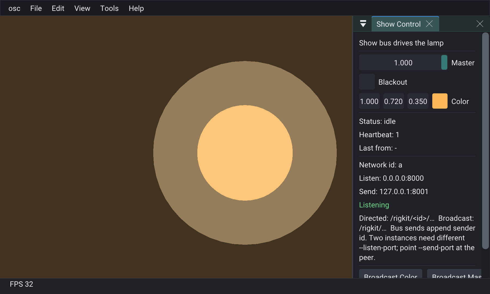

# rigOsc



OSC transport. Show-bus addresses are `/<appName>/<networkId>/<leaf>` and broadcast `/<appName>/<leaf>`. The app registers each leaf.

- UDP listen / send (`UdpSocket` + `OscCodec`). Exclusive unicast bind. Broadcast sends allowed
- TCP opt-in on the same dispatch path. Default framing is a 4-byte big-endian size. `streamFraming` Slip uses SLIP (`0xC0` / `0xDB`). Peer count and packet size are the host's
- One socket thread receives and sends. `update` delivers listeners on the SUDE thread
- IPv4 multicast opt-in (`multicastGroup`, TTL). Joining uses `SO_REUSEADDR` so another listener can share that port. Empty group keeps the exclusive unicast bind
- OSC 1.0 / 1.1 args `i` `h` `f` `d` `s` `S` `b` `t` `c` `r` `m` `T`/`F` `N` `I` and arrays `[` `]`
- Bundles, including a future timetag (held until due)
- Address-pattern listeners (`?` `*` `[]` `{}`, plus pack `**` across `/`)
- `CNetworkIdentity`, `COscEndpoint` - data on the pack
- Bind failures surface in `lastError()` (no fake open)
- Shared CLI for any app: `applyCommandLine` + `commandLineHelp`
- `addBusListener` routes a leaf the app names. The pack does not ship leaf names.

## CLI

After pack register / `setup()`:

```cpp
m_osc->applyCommandLine(args);
```

| Flag | POD |
|------|-----|
| `--network-id` / `--id` | `CNetworkIdentity::networkId` |
| `--bind-address` | `CNetworkIdentity::bindAddress` |
| `--listen-port` | `COscEndpoint::listenPort` |
| `--send-host` | `COscEndpoint::sendHost` |
| `--send-port` | `COscEndpoint::sendPort` |
| `--tcp` / `--tcp-port` | `tcpListen`, `tcpPort` (0 = listen port) |
| `--slip` | `streamFraming` SLIP (default is the size prefix) |
| `--multicast` / `--multicast-ttl` | `multicastGroup`, `multicastTtl` |

Accepts `--key=value` or `--key value`. Logs `id=... listen ... send ... listening=...`.

Paste `rigOsc::commandLineHelp()` into your app’s `--help`.

Addresses: `/<appName>/<networkId>/<leaf>` directed, `/<appName>/<leaf>` broadcast. `oscHost` and this example register `master`, `blackout`, `color`, `status`, and send `heartbeat`. Other apps register their own leaves, or only use `addListener`.

Host reference with author/show + multi-instance: RigKit `examples/oscHost`.

[API/docs](https://rigkid.github.io/rigOsc/)
